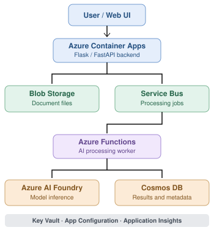
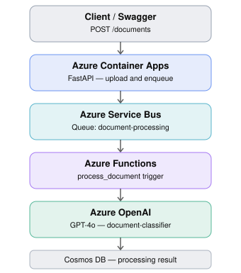

# AI-200 Lab — Azure AI Document Processing

## 1. Objective

Deploy and test an **end-to-end, event-driven document processing application** on Microsoft Azure.

The lab demonstrates how to combine **Cloud, Serverless, Messaging, Storage, Databases and Generative AI** to automatically classify and summarize uploaded documents.

## 2. Architecture
### 2.1 System Architecture


### 2.2 Request Flow


**Application Insights** provides monitoring, execution logs and diagnostics.

## 3. Prerequisites

- An **Azure subscription** that supports Azure Container Apps, Azure Functions, Azure Service Bus, Azure Cosmos DB, Azure OpenAI (GPT-4o), Azure Container Registry, Azure Storage, Key Vault and Application Insights.
- Sufficient quotas and permissions to deploy resources and assign Azure RBAC roles (Owner, RBAC Administrator or equivalent permissions).
- Azure CLI installed and authenticated (`az login`).
- Python 3.11+ and Docker (if building images locally).
- Access to the GPT-4o model in the selected Azure region.

> Some restricted training subscriptions may prevent resource creation, model deployment or RBAC assignments.

## 4. Deploy the lab

Clone or download the project and open a terminal in its root directory.

```powershell
az login
az account set --subscription "<SUBSCRIPTION_ID>"
python azdeploy.py
```

Execute the deployment menu in order:

1. Create Azure infrastructure.
2. Configure Azure OpenAI and supporting services.
3. Configure application identities.
4. Assign RBAC permissions.
5. Build and deploy the API and Azure Function.
6. Validate deployment.

Follow the menu displayed by the script; exact option names may vary.

After deployment, load the generated PowerShell environment variables:

```powershell
. .\generated\.env.ps1
```

Open the API documentation:

```powershell
Start-Process "$env:API_URL/docs"
```

## 5. Test the application

### Test 1 — API availability

```powershell
Invoke-RestMethod "$env:API_URL/health"
```

**Expected:** HTTP 200 and healthy API response.

### Test 2 — Upload a document

Using Swagger UI, call `POST /documents` and upload a `.txt` document.

Alternatively:

```powershell
curl.exe -X POST "$env:API_URL/documents" `
  -F "file=@samples/invoice.txt"
```

**Expected:** A document ID and an initial processing status.

### Test 3 — Retrieve AI results

```powershell
Invoke-RestMethod "$env:API_URL/documents/<DOCUMENT_ID>"
```

**Expected:** Status progresses to `completed`, with the AI-generated classification and summary.

## 6. Verify each Azure service

| Component | What to inspect | Expected result |
|---|---|---|
| **Container Apps** | Console logs and HTTP requests | Upload accepted; message published |
| **Blob Storage** | `documents` container | Uploaded document exists |
| **Service Bus** | Queue metrics: Active, Dead-letter | Message published and consumed; no dead-letter errors |
| **Azure Functions** | `process_document` → Monitor | Successful execution |
| **Azure OpenAI** | Deployment metrics | GPT-4o requests, token usage and latency |
| **Cosmos DB** | `documentsdb` → `results` | Document record with classification, summary and completed status |
| **Application Insights** | Logs, Failures, Transaction search | Execution telemetry and errors, if instrumented |

### Useful monitoring commands

**Service Bus queue:**

```powershell
az servicebus queue show `
  -g $env:RESOURCE_GROUP `
  --namespace-name $env:SERVICEBUS_NAMESPACE `
  -n $env:SERVICEBUS_QUEUE `
  --query "{Active:countDetails.activeMessageCount,DeadLetter:countDetails.deadLetterMessageCount}"
```

**Container App logs:**

```powershell
az containerapp logs show `
  -g $env:RESOURCE_GROUP `
  -n $env:CONTAINER_APP_NAME `
  --type console --follow --tail 100
```

**Application Insights — search by document ID:**

```kql
let documentId = "<DOCUMENT_ID>";
union isfuzzy=true requests, traces, dependencies, exceptions
| where timestamp > ago(24h)
| where tostring(customDimensions) contains documentId
   or tostring(message) contains documentId
   or tostring(name) contains documentId
| order by timestamp asc
```

The query returns only telemetry that was captured and contains the document ID. Azure OpenAI metrics do not automatically expose full prompts and responses.

## 7. Success criteria

The lab is successful when:

- [ ] The API is accessible and accepts a document.
- [ ] The document is stored in Blob Storage.
- [ ] A message is published to Service Bus.
- [ ] The Azure Function consumes the message.
- [ ] GPT-4o processes the document.
- [ ] Cosmos DB contains the final classification and summary.
- [ ] The API returns the completed result.
- [ ] Logs and metrics allow students to investigate the execution.

**Final exercise:** Upload multiple documents, compare their classifications and summaries, inspect the Service Bus queue and Azure Function executions, and deliberately test an invalid document to investigate error handling.

## 8. Cleanup

To avoid unnecessary Azure costs, delete the resource group after completing the lab:

```powershell
az group delete --name $env:RESOURCE_GROUP --yes
```

**Warning:** This permanently deletes all resources in the lab resource group.
